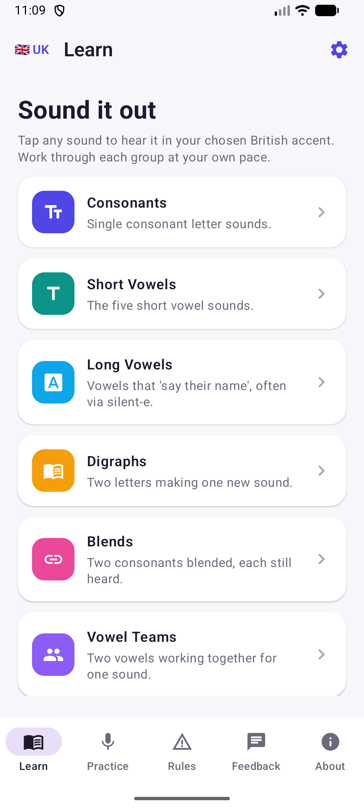

# phonicsapp_android

# Phonics — Pronunciation Trainer for Adults (Android)

A native Android (Jetpack Compose, Material 3) app that helps adults learn English
**pronunciation and phonics**. Tap any sound, word, rule, or sentence to hear it spoken in a
**British** or **American** accent — fully offline. This is the Android mirror of the
[iOS Phonics Pronunciation Coach](https://apps.apple.com/us/app/phonics-pronunciation-coach/id6782569616),
feature-for-feature.



## Features

- **Learn** — the full phonics curriculum: consonants, short & long vowels, digraphs, blends,
  vowel teams, diphthongs, r-controlled vowels, and soft c/g. Every phoneme has IPA, a
  plain-language articulation cue, example words, and one-tap voice-over.
- **Practice** — graded speaking sessions:
  - **Intonation & Emotion** — hear one sentence spoken happy, sad, angry, excited, as a
    question, and more. Pitch, pace, and stress are reshaped per emotion so learners hear how
    intonation carries meaning.
  - **Minimal pairs** (ship/sheep), **tongue twisters**, **short everyday messages**, and
    **sentence drills**.
- **Rules** — the exception/irregular spellings phonics can't predict: silent letters, the many
  sounds of *ough*, soft c/g, *i-before-e*, tricky sight words, the schwa, and doubling/drop-e.
- **Accent + voice** — switch between 🇬🇧 British (en-GB) and 🇺🇸 American (en-US) anywhere, and
  pick a **female or male** voice in Settings; choices are persisted.
- **Feedback** — send a note straight to the team via WhatsApp.
- **About** — app info, developer, learning reference, audio attribution, and version.

## Voice-over

- **Words** — example words, minimal pairs, and rule examples play **real human recordings**
  sourced from Wiktionary / Wikimedia Commons (CC BY-SA), bundled for offline use
  (`app/src/main/assets/word_audio`, 253 clips), with an Android TTS fallback for any word
  without a recording.
- **Phoneme sounds** — "Hear the sound" demonstrates a phoneme via the on-device
  `TextToSpeech` engine fed a hidden pseudo-word cue tuned per sound (e.g. /iː/ → "ee",
  /eɪ/ → "ai") so the engine produces the isolated sound as closely as it can.
- **Intonation & Emotion** — emotion presets reshape the utterance's speech rate, pitch,
  volume, delay, and punctuation so the synthesizer applies real rising/falling prosody.

Audio attribution is shown in the in-app **About** tab as required by the CC BY-SA license.

## Project structure

```
app/src/main/java/com/tertiaryinfotech/phonics/
  MainActivity.kt           App entry
  data/                     Models (Phoneme, ExceptionRule, Emotion, PracticeKind) + ContentLibrary
  speech/Speaker.kt         Android TTS + MediaPlayer (human word recordings, accent fallback)
  ui/                       Theme, Components, Root tab nav, Learn, Practice, Rules,
                            Feedback, About, Settings screens (Jetpack Compose, Material 3)
app/src/main/assets/word_audio/   253 bundled human pronunciation clips (m4a)
```

## Build & run

```bash
./gradlew :app:assembleDebug        # debug APK
./gradlew :app:bundleRelease        # signed release AAB (needs keystore.properties)
```

- **Min SDK:** 26 (Android 8.0) · **Target SDK:** 36 · **UI:** Jetpack Compose, Material 3
- Release signing reads `keystore.properties` (not committed) pointing at your upload keystore.

## Reference

Curriculum structure follows standard synthetic-phonics practice — see
[Phonics (Wikipedia)](https://en.wikipedia.org/wiki/Phonics).

## Developer

[Tertiary Infotech Academy Pte Ltd](https://www.tertiaryinfotech.com)
